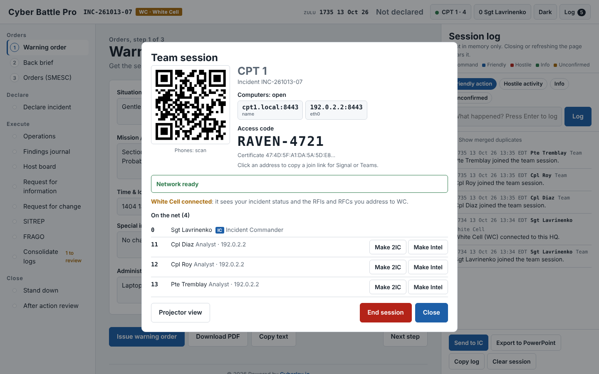
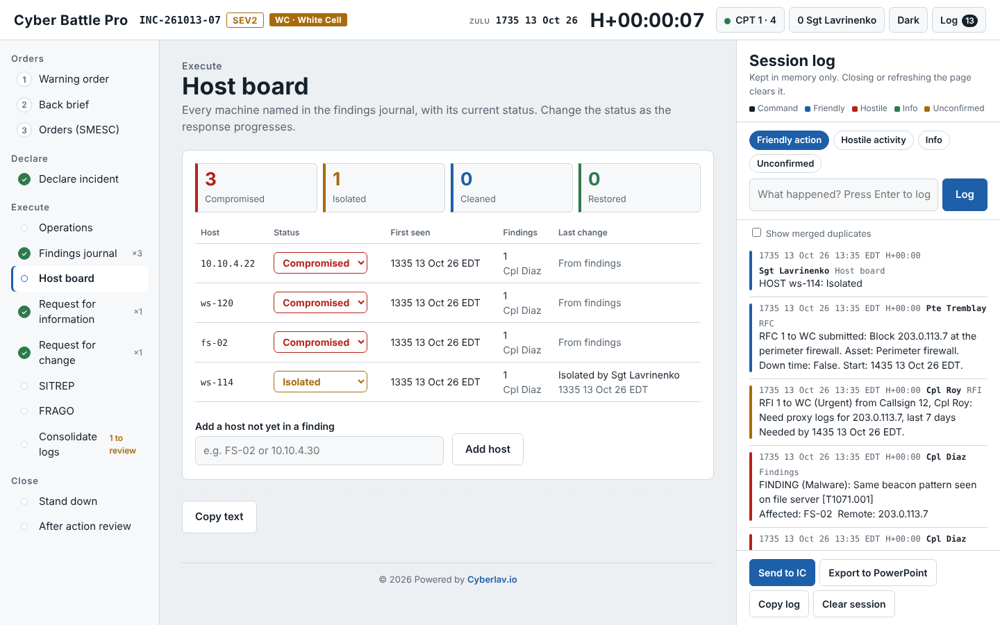
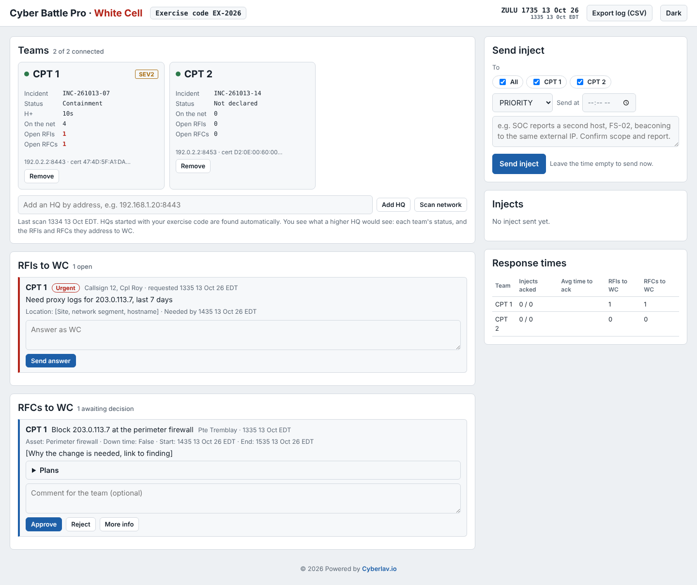
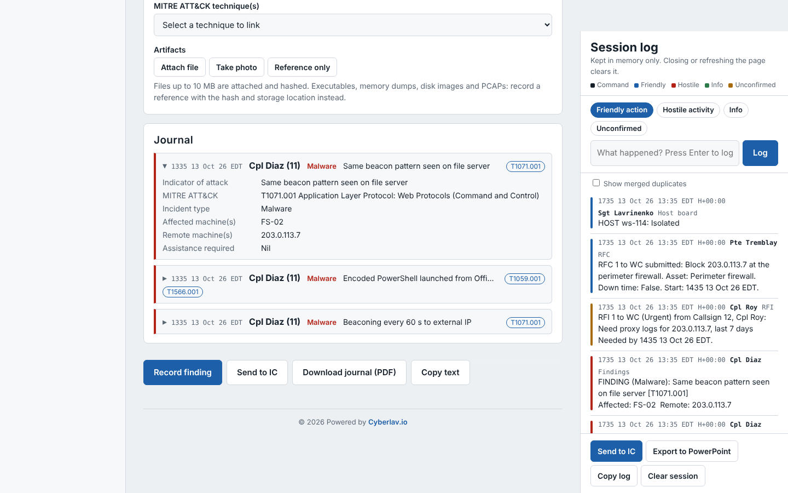
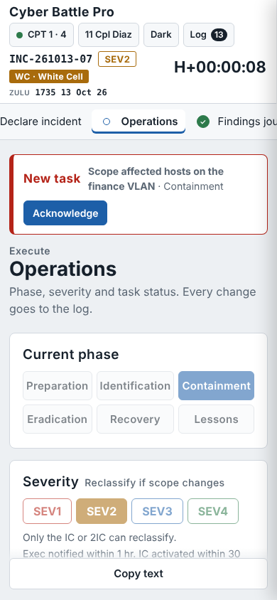

<p align="center">
  <picture>
    <source media="(prefers-color-scheme: dark)" srcset="public/brand/logo-dark.svg">
    
  </picture>
</p>

# Cyber Battle Pro

Cyber Battle Pro (CBP) is an incident response command tool for cyber protection teams. It walks a section from the warning order to the after action review using NATO and Commonwealth battle procedure on top of SANS PICERL, and keeps the whole team on one live picture during the incident.

A playbook tells you what to do. CBP helps you lead the people doing it.

It runs on one Windows laptop with no installation and no internet. The Incident Commander starts `CBP-HQ.exe`, analysts join from a browser on their phone or computer, and everything stays on the local network. Exercises that stop for the night are paused and resumed the next morning with the same code and log. For exercises, the same file runs as a White Cell console that plays the higher HQ for several teams at once.



## What it does

**Orders and reporting**
- Warning order, back brief and SMESC orders in Annex C sequence, each with a formatted PDF
- Incident declaration with 5W and SEV1 to SEV4 classification
- SITREP, FRAGO, RFI and RFC templates, stand down and after action review
- Zulu time throughout, with local time where people act on it

**Running the incident**
- Task board per PICERL phase, prefilled with the people on the net; each member gets a personal notification and acknowledges the task
- Findings journal with automatic timestamps, MITRE ATT&CK techniques, attached evidence hashed with SHA 256, and a chain of custody log
- Host board fed by the findings: compromised, isolated, cleaned, restored
- Deduplicated IOC table, CSV export, merged team timeline
- Command rights enforced by the HQ: only the IC and the 2IC issue orders, declare, change phase or severity, and stand down
- Pause overnight and resume next morning, with an optional passphrase that encrypts the saved session

**Outputs**
- PowerPoint of the whole session (timeline, findings, hosts, IOCs, evidence, SITREPs, AAR)
- Findings journal as a PDF with screenshots at full resolution and every attached file embedded
- Copy as text for any order or report, ready to paste into Teams or Signal

**White Cell for exercises**
- Finds every team HQ on the network by itself
- Sees each team's status and only the RFIs and RFCs addressed to WC
- Answers RFIs, approves or rejects RFCs, sends timed injects, and measures how fast each team responds

| | |
|---|---|
|  |  |
|  |  |

## Quick start

1. Download `CBP-HQ.exe` from the [latest release](../../releases/latest) and copy it to a folder on the IC laptop.
2. Connect the laptop to the section network (not the compromised one) and double click the file. If SmartScreen appears, choose *More info* then *Run anyway*; if Windows asks about network access, choose *Allow*.
3. Type the team for this session, for example `CPT 1`, then the White Cell exercise code or Enter.
4. The app opens in the browser. Enter your name and callsign. The Section panel shows the QR code, the address and the access code.
5. Analysts scan the QR code, or type the address (for example `cpt1.local:8443`), and enter the code with their name and callsign.

For the White Cell, run the same file and type `WC` as the team.

The full procedure for ICs, analysts and the White Cell is in [docs/QUICKSTART.md](docs/QUICKSTART.md). Options, certificates, troubleshooting and security notes are in [docs/FIELD-HQ.md](docs/FIELD-HQ.md).

## Run from source

Node.js 18 or newer.

```
npm ci
npm start                 # team HQ
npm run white-cell        # White Cell console
npm start -- --help       # all options
```

`public/index.html` also works on its own in any browser, without the HQ, as a single user tool.

## Build the executables

```
npm ci
npm run build:win         # dist/CBP-HQ.exe
npm run build:linux       # dist/CBP-HQ-linux
```

Pushing a tag such as `v1.9.0` runs the GitHub workflow in `.github/workflows/release.yml`, which builds both executables on their own platforms and attaches them to a release.

The executables are not code signed, so Windows SmartScreen warns on first launch.

## How it fits together

```
 IC laptop (CBP-HQ.exe)                         White Cell laptop (CBP-HQ.exe, team "WC")
 ┌──────────────────────────────┐               ┌───────────────────────────────┐
 │ serves the app               │  exercise     │ finds the HQs on the network  │
 │ relays the session log (WSS) │◄──── code ────│ sees status, RFIs, RFCs to WC │
 │ saves for pause and resume   │               │ answers, decides, injects     │
 └──────────────┬───────────────┘               └───────────────────────────────┘
                │ access code
     ┌──────────┼──────────┐
  Analyst    Analyst    Analyst      (browser on phone or computer)
```

| File | Role |
|---|---|
| `server.js` | Field HQ: HTTPS and WebSocket server, access control, command rights, pre flight network check, White Cell link |
| `store.js` | Saved sessions: checkpoint, pause and resume, optional AES 256 GCM encryption |
| `wc.js` | White Cell mode: discovery, connections to every HQ, console server |
| `public/index.html` | The app used by the IC and the analysts, also usable standalone |
| `public/wc.html` | The White Cell console |
| `public/brand/` | Logo set shared with cyberbattlepro.ca: light and dark SVG, favicon, app icons, social preview image |

## Data handling

- The HQ saves the session in the `sessions` folder next to the exe so it can be paused and resumed. With a passphrase the file is encrypted with AES 256 GCM; without one it is only compressed. **End session** deletes it. `--no-save` keeps everything in memory only.
- Every device keeps its own copy in memory; if the HQ restarts, devices reconnect and reseed it.
- A member's device keeps the access code, name and callsign for 72 hours so it can rejoin without the code, including after an overnight pause. It is erased when the member leaves, when the IC ends the session, or when the HQ refuses the code.
- Intended for exercises, training and unclassified work. Do not enter classified information.

## Background

CBP grew out of the incident response toolkit on [cyberlav.io](https://cyberlav.io): the reference plan, the job aid, the SMESC order builder and the back brief builder. The orders, severity matrix, SITREP, chain of custody and AAR follow the annexes of that plan.

See [CHANGELOG.md](CHANGELOG.md) for the version history.

## License

Cyber Battle Pro is free software under the [GNU Affero General Public License v3](LICENSE) (AGPL-3.0-only), with additional terms in [NOTICE](NOTICE):

- keep the visible credit "Cyber Battle Pro by Alexander Lavrinenko · Powered by cyberlav.io" in the interface;
- mark modified versions as different from the original;
- the name Cyber Battle Pro and the winged helmet logo are not licensed to modified versions.

Using it is free, for military units and companies alike. If you change it and give it to others, or run a changed version for others over a network, you share your changes under the same license. Organizations that need other terms can ask for a commercial license through [cyberlav.io](https://cyberlav.io).

## Contributing

Bug reports and ideas are welcome as issues. Code goes through pull requests and needs a single signature of the [Contributor License Agreement](CLA.md): the CLA bot asks for it on your first pull request. See [CONTRIBUTING.md](CONTRIBUTING.md).

© 2026 Alexander Lavrinenko · [cyberlav.io](https://cyberlav.io)
